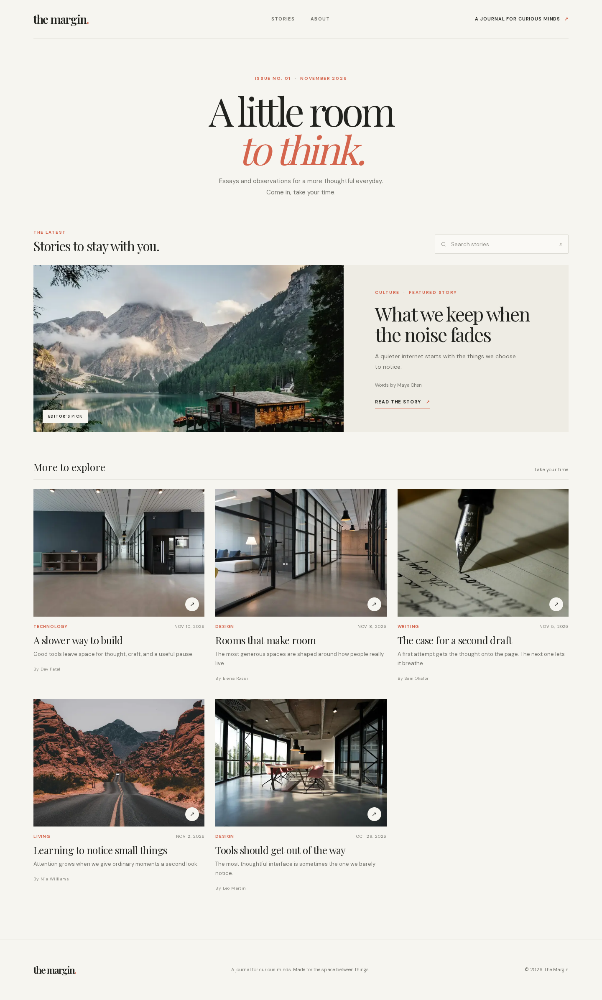
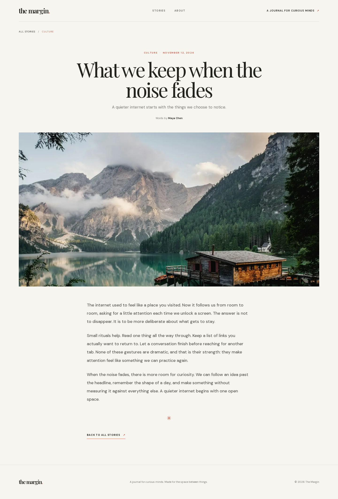

# The Margin — Next.js Blog

A responsive editorial blog built with the Next.js App Router. The homepage is server-rendered, posts have dynamic article pages, and search filters the hydrated post cache as you type.

**Source:** [UmarAlMukhtar/full-fledged-blog-application-next-js](https://github.com/UmarAlMukhtar/full-fledged-blog-application-next-js)

**Live app:** [full-fledged-blog-application-next.vercel.app](https://full-fledged-blog-application-next.vercel.app)

## Screenshots

### Homepage



### Article



## Features

- Server-rendered homepage and individual posts.
- Dynamic `/posts/[slug]` routes with a custom 404 page.
- MockAPI-compatible collection endpoint with validated records and a local seed fallback.
- Instant search across title, excerpt, author, and category.
- TanStack React Query prefetching and hydration.
- Responsive, keyboard-accessible editorial layout.
- Per-page canonical, Open Graph, and title/description metadata.

## Local setup

Requirements: Node.js 20.9 or later and npm.

```bash
npm install
npm run dev
```

Open [http://localhost:3000](http://localhost:3000). The app runs immediately from the bundled seed posts. To use a mock service, copy `.env.example` to `.env.local` and set `MOCK_API_URL` to an HTTPS collection endpoint that returns a JSON array.

## Mock API shape

Each record needs a unique URL-safe `slug`, a `title`, and an ISO date in `publishedAt`. Optional fields are `excerpt`, `content`, `author`, `coverImage`, `coverImageAlt`, and `category`.

```json
[
  {
    "slug": "a-slower-way-to-build",
    "title": "A slower way to build",
    "excerpt": "Good tools leave space for thought.",
    "content": "The full article text goes here.",
    "author": "Dev Patel",
    "publishedAt": "2026-11-10T09:00:00.000Z",
    "coverImage": "https://images.unsplash.com/photo-1497366216548-37526070297c",
    "coverImageAlt": "A sunlit shared work table",
    "category": "Technology"
  }
]
```

The endpoint must be public over HTTPS and return a JSON array. Invalid, empty, or unavailable responses use the seed posts. Cover images are accepted from `images.unsplash.com`; other or missing image URLs use a safe fallback.

## Routes

| Route | Purpose |
| --- | --- |
| `/` | Server-rendered homepage and client-side search |
| `/posts/[slug]` | Server-rendered individual article |
| `/api/posts` | JSON collection |
| `/api/posts/[slug]` | One post as JSON, or a 404 response |

## Deployment

The public app is deployed on Vercel from the GitHub repository. Set `NEXT_PUBLIC_SITE_URL` to your canonical domain when using a custom domain. Add `MOCK_API_URL` in project environment variables if you have a MockAPI collection. If it is omitted, the public site uses the seed posts.

## Project checks

```bash
npm run lint
npm run build
```
